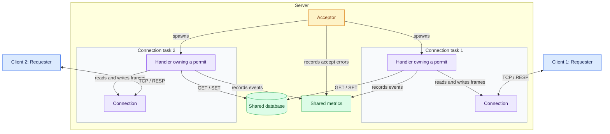
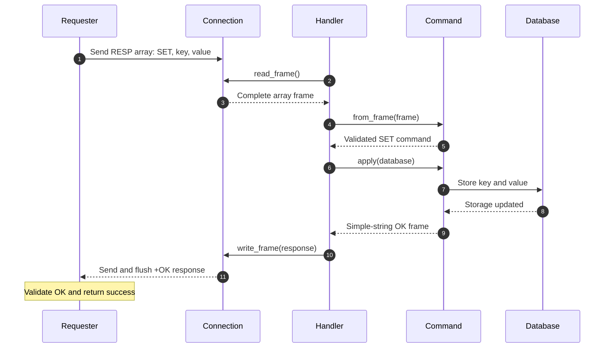

# Mini-Redis

A Redis-like TCP server and command-line client written in Rust with Tokio. It supports in-memory GET and SET operations over a RESP subset, with incremental frame parsing, concurrent connection handling, resource limits, coordinated shutdown, and unit and integration tests.

This educational project explores asynchronous I/O, shared state, resource ownership, error handling, and protocol validation in Rust. It implements a small subset of Redis functionality and is not a drop-in replacement for Redis.

## Supported behavior

- `SET key value` stores a value, replacing any existing value for that key.
- `GET key` returns the stored value, or a null response when the key is missing.
- Command names in RESP requests are ASCII case-insensitive. The CLI uses lowercase `get` and `set`. Keys must be valid UTF-8; bulk-string values can contain arbitrary bytes.
- Each CLI invocation sends one command. The library's `Requester` supports sequential commands over the same connection, subject to the recovery requirements described below.

The frame layer supports simple strings, error strings, signed integers, bulk strings, nulls, and arrays. Commands are encoded as arrays; supporting a frame type does not make it a valid command argument.

## Quickstart

Install Rust and Cargo. The manifest declares Rust 1.91 as the minimum version; CI runs the current stable toolchain on Ubuntu.

Clone and build the project:

```bash
git clone https://github.com/Qihang-Li/mini-redis.git
cd mini-redis
cargo build --bins --locked
```

Start the server:

```bash
cargo run --locked --bin server
```

In another terminal, from the same project directory:

```bash
cargo run --locked --bin client -- set greeting hello
# OK

cargo run --locked --bin client -- get greeting
# b"hello"

cargo run --locked --bin client -- get missing
# (nil)
```

The client prints returned bytes using Rust's debug formatting. Its CLI accepts string values and sends their UTF-8 bytes.

Both binaries default to `127.0.0.1:6379`. The client accepts an explicit IP address and port:

```bash
cargo run --locked --bin client -- --addr 127.0.0.1:6379 get greeting
cargo run --locked --bin client -- --help
```

Hostnames are not supported by `--addr`. The server's bind address is configured in [`src/config.rs`](src/config.rs), rather than through a server CLI option.

Press Ctrl+C in the server terminal to request shutdown. The server logs final metrics after its completion-tracking channel closes. Shutdown has no fixed completion deadline.

## Architecture



The diagram shows two illustrative connection tasks. Tokio schedules these asynchronous tasks on its runtime; the configured permit limit controls admission.

`Acceptor` manages admission and creates connection tasks. Each `Handler` owns its connection and permit, processes requests sequentially, and accesses shared database and metrics handles.

`Connection` buffers TCP input and uses `Frame` to distinguish complete frames, incomplete input, and malformed input. `Command` and `Parse` validate command arguments before accessing the database.

Shutdown uses a broadcast channel for notification and an MPSC channel for completion tracking. No completion messages are sent: the receiver observes closure when every tracking sender has been dropped.

### A successful SET request



TCP reads do not necessarily correspond to complete requests. The connection retains incomplete input until more bytes arrive and preserves any following frames for subsequent reads.

## Implementation choices

### Bounded incremental parsing

The connection checks whether a complete frame is available before consuming it. Limits on unread buffered bytes, array length, and nesting depth constrain individual inputs while allowing fragmented frames and multiple frames received together.

These are protocol-input limits. They do not impose a total memory limit on the server or its database.

### Waiting admission at connection capacity

The acceptor acquires a semaphore permit before accepting a connection. A handler owns that permit until it is dropped, limiting the number of admitted handlers.

When every permit is occupied, the accept loop waits for a slot to become available. Pending clients may still complete their TCP connection through the operating system's queue and receive service later. This behavior depends on queue capacity and client timeouts; it does not provide immediate overload rejection or guaranteed eventual service.

### Shared storage with short synchronous locking

The database uses `Arc<Mutex<HashMap<String, Bytes>>>`. GET and SET perform short synchronous operations, and database methods do not hold a mutex guard across an `.await`.

GET clones a `Bytes` handle to share the existing payload storage. This avoids copying that stored payload for the lookup result, although frame decoding still performs copies.

### Cleanup tied to ownership

Semaphore permits and completion-tracking senders are released when their owners are dropped. A separate guard balances the active-connection counter when `Handler::run()` exits, including error returns.

The server also preserves the accept loop or Ctrl+C listener's result until after the shared shutdown sequence. A failure can therefore be reported after cleanup rather than being discarded or causing an immediate return.

## Defaults and limits

Defaults are defined in [`src/config.rs`](src/config.rs).

| Setting                                       | Default or limit                                                                |
| --------------------------------------------- | ------------------------------------------------------------------------------- |
| Server bind address                           | `127.0.0.1:6379`                                                                |
| Client destination                            | `127.0.0.1:6379`                                                                |
| Connection permits                            | 512                                                                             |
| Initial requested read-buffer capacity        | 4 KiB                                                                           |
| Maximum unread buffered bytes per connection  | 64 KiB                                                                          |
| Maximum elements in each array                | 1,023                                                                           |
| Maximum array nesting depth                   | 32 layers                                                                       |
| Server timeout for reading one complete frame | 10 minutes                                                                      |
| Client timeout                                | 10 seconds separately for connecting, writing a request, and reading a response |

Receiving additional partial bytes does not restart the server's frame-read timeout. The client's write and response-read operations each receive their own timeout; they do not share one command deadline.

The 64 KiB limit applies to unread buffer length, including frame encoding. It is not a bound on allocated capacity or total connection memory.

## Testing and CI

Run the same checks used by CI:

```bash
cargo fmt --all -- --check
cargo check --all-targets --locked
cargo test --locked
cargo clippy --all-targets --locked -- -D warnings -W clippy::pedantic
```

The committed `Cargo.lock` records dependency versions. `--locked` makes Cargo fail if resolving the project would require changing that lockfile.

| Area                 | Selected checks                                                                                                 |
| -------------------- | --------------------------------------------------------------------------------------------------------------- |
| Frame parsing        | Malformed and incomplete input, CRLF delimiters, integer boundaries, array length and nesting, cursor positions |
| Connection I/O       | Fragmented frames, retained buffered bytes, EOF, buffer boundaries, frame serialization                         |
| Commands and storage | Argument validation, ASCII command matching, GET/SET behavior                                                   |
| Handler cleanup      | Active counts after EOF and read/write failures; request and response counters                                  |
| Client CLI           | Rejection of an invalid address                                                                                 |
| Server integration   | SET/GET, shutdown, idle timeout, protocol-error responses, waiting for released capacity                        |
| Concurrent clients   | 100 client tasks, each performing SET followed by GET on a distinct key                                         |

The concurrency test checks returned values and final metrics for 200 commands. It is a correctness test, not a throughput or latency benchmark.

Network test scenarios have an outer five-second Tokio timeout. Some operations also retain shorter timeouts. The incomplete-frame and connection-capacity checks deliberately expect their shorter timeout to expire.

The server integration tests start `Acceptor` directly. They do not launch the server executable or exercise an operating-system Ctrl+C signal. CI uses stable Rust; it does not separately test the declared minimum Rust version.

## Engineering fixes

### Preserving frame boundaries

Line-based frames must end with CRLF. The parser now rejects a standalone LF as malformed input, while preserving the distinction between invalid input and an incomplete trailing CR. Regression tests exercise malformed delimiters and cursor behavior through frame checking and parsing.

### Keeping connection metrics correct on error paths

Cleanup placed only at the end of a handler can be skipped by an early error return. Active-connection accounting now uses a guard whose `Drop` implementation decrements the counter. Tests cover EOF, malformed input, and a response-write failure, including the distinction between receiving a request and successfully writing its response.

## Limitations and library usage notes

The database is in memory only. There is no persistence, expiration, eviction, or total database-size limit. The server implements GET and SET without authentication, TLS, or the wider Redis command set.

Shutdown is cooperative. Response writes and the final completion wait have no deadline, so a blocked write can delay shutdown. Library users must arrange shutdown subscriptions before broadcasting, because new subscribers do not receive earlier notifications.

After a command timeout, or cancellation after its future has been polled, callers must drop the `Requester` and reconnect before issuing another command. The implementation documents this requirement but does not prevent reuse automatically. Reusing the connection can associate a delayed response with a later request. Reconnecting also does not establish whether a previous SET was applied.

Callers constructing `Frame::Simple` or `Frame::Error` directly must exclude CR and LF from their payloads, including inside arrays. `write_frame()` does not validate this requirement.

Metrics record server-side events. In particular, a successfully written response does not prove that the client received or processed it. There is no metrics HTTP endpoint or performance benchmark.

## License

Licensed under the [MIT License](LICENSE).